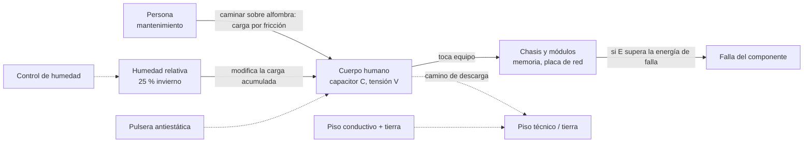

# P1 – Ficha de encuadre del caso (v4)
Fecha real: 2026-11-18 · Estado: EN PROCESO · Valores del Eje I adoptados · Caso confirmado por la estudiante el 2026-11-18
Fuente de todo el contenido del caso: Banco de Casos AE4 (Anexo XI), caso F1-01. Lo que no sale de allí se marca como `[PROPUESTA]` y debe ser confirmado por Florencia.

## 1. Identificación del caso
- Código: **F1-01** · Familia F1 – Centros de datos y salas de servidores
- Título: Sala de servidores de un hospital escuela: fallas por descarga electrostática
- Estudiante: Florencia (apellido y DNI: completar en la carátula)

## 2. Descripción del sistema (según el caso)
La sala de servidores funciona sobre piso técnico elevado, con alfombra en el pasillo de acceso y humedad relativa baja en invierno. En seis meses hubo tres fallas de módulos de memoria y una placa de red quemada, siempre en días secos y siempre después de tareas de mantenimiento realizadas por el personal.

## 3. Función del sistema en Sistemas de Información
`[PROPUESTA]` La sala aloja los servidores del hospital escuela; su disponibilidad y la integridad de sus componentes sostienen los servicios de información que dependen de ellos. Ajustar con tus palabras.

## 4. Problema que se analiza
Las fallas de hardware aparecen en días secos y tras el contacto del personal con los equipos: se sospecha de descarga electrostática (ESD). Hay que explicarlo con la física y elegir cómo mitigarlo.

## 5. Objetivo del análisis
Diagnosticar el sistema desde la física, verificar por simulación y fundamentar la decisión profesional pedida por el caso (sección 8).

## 6. Decisión profesional que pide el caso
Elegir y fundamentar una estrategia de mitigación de ESD entre tres alternativas: (A) piso conductivo con puesta a tierra, (B) control de humedad relativa, (C) protocolo obligatorio de pulsera antiestática. Justificar cuál protege más por unidad de costo y qué combinación se adopta.
Nota: el "costo" necesita datos. El caso no da precios, así que hay que usar fuentes o una estimación justificada, o comparar solo cualitativamente.

## 7. Diagrama de bloques `[PROPUESTA]`

## 8. Componentes principales
Cuerpo del técnico · piso técnico elevado · alfombra del pasillo · módulos de memoria · placa de red · (según el caso, protecciones TVS o de sujeción en las entradas de la placa de red).

## 9. Magnitudes (datos orientativos del Banco; NO son valores definitivos)
| Magnitud | Rango dado por el caso | Valor adoptado | Fuente |
|---|---|---|---|
| Capacitancia del cuerpo humano, C | 100 a 150 pF | **150 pF** (hipótesis: caso más desfavorable) | Rango: caso F1-01; criterio: ver P2 Eje I |
| Potencial adquirido, V | 2 a 15 kV según humedad | **15 kV** (hipótesis: caso más desfavorable) | Rango: caso F1-01; criterio: ver P2 Eje I |
| Resistencia del calzado | 10⁶ a 10⁹ Ω | A ADOPTAR | Caso F1-01 (orientativo) |
| Energía de falla de un CI CMOS, E_falla | 10 a 100 µJ | **10 µJ** (hipótesis: componente más sensible) | Rango: caso F1-01; criterio: ver P2 Eje I |
| Humedad relativa invernal | 25 % | 25 % | Caso F1-01 |
| Resistencia del camino a tierra del piso técnico | NO dada por el caso y NO medida | no se adopta un valor para el hospital; se calculan escenarios de 2×10⁶, 3,5×10⁷ y 10⁹ Ω (valores de normas y fabricantes) y 1,5 kΩ para la descarga directa | P2 Eje II (fuentes en P5) |
| Tiempo de subida del pulso ESD | "nanosegundos" (sin valor) | FALTA | norma o doc. técnica |
| Tensión de disparo, tiempo de respuesta y capacidad del diodo TVS | no dados | FALTA | hoja de datos de un TVS real |

## 10. Qué pide el caso en cada eje (resumen del Banco)
- Eje I: cuerpo como capacitor cargado por triboelectricidad: carga, potencial y energía almacenada; comparar con la energía de falla de un CI CMOS.
- Eje II: resistencia del camino a tierra del piso técnico, corriente de descarga y constante de tiempo RC.
- Eje III: campo magnético del pulso de descarga y acoplamiento inductivo sobre cables de señal cercanos.
- Eje IV: contenido espectral del pulso (subida de ns) y capacidad de radiar dentro de la sala.
- Eje V: diodos TVS y de sujeción en la placa de red: tensión de disparo, tiempo de respuesta y capacidad parásita.

## 11. Hipótesis y simplificaciones `[PROPUESTA]`
- El cuerpo se modela como un capacitor C cargado a una tensión V que se descarga por una resistencia (modelo de cuerpo humano). Válido como aproximación de primer orden.
- Se trabaja con un valor adoptado dentro de cada rango del caso, justificado, y se muestra el efecto de variarlo.
- No se consideran otras causas de falla (calidad de la alimentación, temperatura), porque el caso solo vincula las fallas con los días secos y el mantenimiento.

## 12. Historial
| Versión | Fecha real | Qué cambió |
|---|---|---|
| v1 | 2026-11-18 | Plantilla sin datos |
| v2 | 2026-11-18 | Datos del caso F1-01 cargados; magnitudes en rangos pendientes de adoptar |
| v3 | 2026-11-18 | Se adoptan C, V y E_falla para el Eje I (caso más desfavorable), con comparación contra todo el rango en P2 |
| v4 | 2026-11-18 | Se aclara el tratamiento de la resistencia del piso técnico (escenarios, sin valor medido) |
